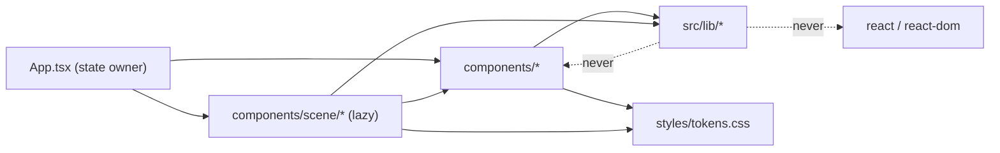
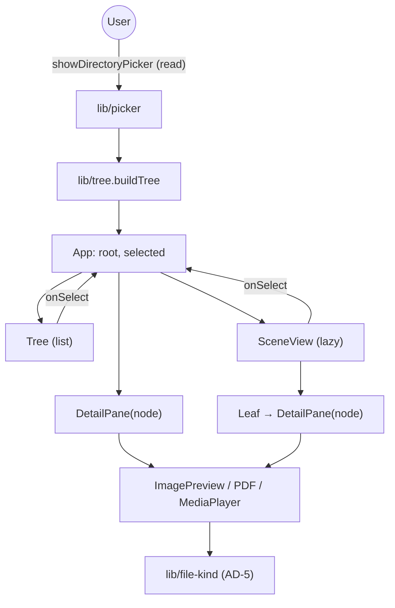

# Architecture Spine — file-browser

## Design Paradigm

**Functional core / imperative shell.** All domain logic is pure and framework-free; React and three.js are a shell that renders it and owns every side effect.

| Layer | Where | Role |
| --- | --- | --- |
| Core | `src/lib/` | Pure, deterministic, synchronous. Tree, filter, metadata, file-kind, layout maths. `picker.ts`, `image.ts`, `webgl.ts` are the only modules touching browser APIs. |
| Shell (list) | `src/App.tsx`, `src/components/` | State owner, effects, DOM. |
| Shell (3D) | `src/components/scene/` | Lazy-loaded; per-frame state in a ref. |
| Design values | `src/styles/tokens.css` | Single source of every color, spacing, radius, font, shadow. |



## Invariants & Rules

### AD-1 — The core never knows the shell [ADOPTED]

- **Binds:** all; FR-5, FR-6 and any new `src/lib/` module.
- **Prevents:** domain logic (filtering, classification, layout, parsing) drifting into components where it cannot be tested without a DOM.
- **Rule:** `src/lib/**` imports no `react`, `react-dom`, `react/*`, `react-dom/*`, and nothing from `src/components/`. It has no `.tsx`, no JSX, no hooks. Only the React-import ban is mechanically enforced today (ESLint `no-restricted-imports`); the no-components-import rule is by review (see Deferred). Dependencies point shell → core only. A behavior change in `src/lib/` ships with a test in the neighboring `__tests__/`, built from in-memory `File` fixtures.

### AD-2 — Read-only and offline by construction [ADOPTED]

- **Binds:** FR-1; all previews and the mini-player.
- **Prevents:** a feature quietly adding a network call, persistence, or a write to the user's folder.
- **Rule:** `src/lib/picker.ts` is the only module that opens the File System Access picker, and only as `showDirectoryPicker({ mode: 'read' })`; `src/lib/tree.ts` only reads the returned handle (`entries()`), never writes. There is no fallback: where the API is missing, `FolderPicker` shows an explicit "not supported" message and offers no picker, and no `<input webkitdirectory>` exists (`[ADOPTED]`, decided by the author). No `fetch`, `XMLHttpRequest`, `WebSocket`, `sendBeacon`, external URL or CDN. No `localStorage`, `sessionStorage`, `indexedDB`, cookies. No `createWritable`, `getFileHandle(…, { create: true })`, `removeEntry`. These bans are enforced by review and tests, not by lint. Every asset (fonts, textures, the PDF worker via `?url`) is bundled. No telemetry or error reporting leaves the machine. Preview and playback sources come only from the picked `File` (object URL or bytes), never from a remote source.

### AD-3 — One immutable tree per pick, `path` is identity [ADOPTED]

- **Binds:** FR-2, FR-3, FR-5; every consumer of `TreeNode`.
- **Prevents:** two units holding different copies of the tree, or keying UI state by index or by object reference.
- **Rule:** `App` builds the root `TreeNode` once per pick with `buildTree` and passes it down read-only. Nothing mutates a `TreeNode`; `filterTree` derives a new tree and returns the same node when nothing is dropped. `TreeNode.path` (slash-joined, relative to the picked root) is the only identity for selection, expansion and React `key`s. Directories sort before files, then alphabetical. The tree is a **snapshot**: no watching and no refresh. A file that disappears or fails to read after the pick surfaces as an explicit error (AD-6), never a crash or a silent blank.

### AD-4 — Selection has one owner; panes are functions of their node

- **Binds:** FR-2, FR-3, FR-4, FR-6 to FR-11.
- **Prevents:** the list view and the 3D view disagreeing on what is selected, or a preview that behaves differently depending on where it is mounted.
- **Rule:** `App` owns `selected: TreeNode | null`. Views report choices through `onSelect` and never keep their own copy of a node: the scene's open Leaf is a presentation flag over `selected`, not a second `TreeNode` (today `SceneView.openNode` duplicates it; converge on one owner). `DetailPane` is a stateless router: it picks a preview by `FileKind` (AD-5) and renders it with the node as a prop. Each preview component owns its own async state and error (AD-6) and reads no view state. The same `DetailPane` mounts in the list layout and inside the 3D Leaf. Selection and view-local expansion state reset on each new pick (list-view expansion is local `useState` today and must be reset too). The filter query is owned by `App` (`[ADOPTED]`, decided by the author) and passed to both views: the 3D `FilterSign` and the list view's `ListFilter` edit the same query, both derive their tree with `filterTree`, and a new pick clears it. A view never holds its own copy of the query.

### AD-5 — One classifier decides what a file is

- **Binds:** FR-6 to FR-11; `DetailPane`, `scene-layout` (`leafCategory`), `Leaf`, the mini-player.
- **Prevents:** the detail pane and the 3D leaf disagreeing on whether a file is an image, a PDF, audio or video; components sniffing MIME or extension on their own.
- **Rule:** A single pure `src/lib/` module (`file-kind.ts`) exports the `FileKind` type (`image | pdf | audio | video | other`) and the function that classifies a `File`. `FileKind` is the only kind vocabulary: `isImageFile`, `isPdfFile`, `leafCategory`, `describeKind` and any new media check derive from it, and every per-kind lookup (scene colors, labels, preview choice) is an exhaustive `Record<FileKind, …>` so a new kind fails typecheck until each is handled. No component inspects `file.type` or the extension directly. Precedence: a specific allowlisted MIME wins; an empty, generic or ambiguous MIME (`''`, `application/octet-stream`, container types such as `video/mp2t` that browsers report for source files like `.ts`) defers to the extension; the mapping is one table with tests. A new kind adds its scene color token to `tokens.css` and `useSceneTheme` in the same change. Whether the browser can actually play a classified file is decided at runtime by the media element's error event (AD-7), never guessed in `src/lib/`.

### AD-6 — Every async resource is keyed to a file, released on cleanup, and fails loudly

- **Binds:** FR-7, FR-8, FR-10, FR-11.
- **Prevents:** leaked object URLs, a stale async result overwriting the current selection, and failures that leave the pane blank without telling the user.
- **Rule:** A preview or player acquires its resource (object URL, decoded PDF, media element) in an effect keyed on the `File`, and the component is keyed by `node.path` so a new selection remounts it. The cleanup revokes the URL (`URL.revokeObjectURL`), destroys the PDF document, and stops playback. A media URL is revoked only in that cleanup, never on a `load`/`loadedmetadata` event (unlike the one-shot `readImageDimensions`) and not when playback ends, so the user can replay `[ASSUMPTION]`; this narrows PRD FR-10's "revoked when playback ends or the selection changes" to selection change and unmount. Async effects set state only if not cancelled. A failure to read or render shows an explicit message in the pane (the `detail-pane__error` pattern); an empty `catch` or `() => {}` is not allowed (today `ImagePreview`'s PDF path does this; fix it, do not copy it). Every `URL.createObjectURL` has its `revokeObjectURL` on success and error paths.

### AD-7 — One mini-player for audio and video, native controls, bound to the node

- **Binds:** FR-9, FR-10, FR-11.
- **Prevents:** separate audio and video players with different controls, state and cleanup; two media elements playing at once; playback surviving a change of selection.
- **Rule:** A single `MediaPlayer` component handles both kinds (per AD-5), rendered by `DetailPane` for the selected node `[ASSUMPTION: the mini-player lives in the detail pane]`. It uses the native `<audio>`/`<video>` element with `controls`, which gives play/pause, seek, volume, duration and keyboard operation without custom code. Playback starts only on a user action `[ASSUMPTION]`. `DetailPane` is the only mount point and renders one node, so at most one player exists, provided a hidden or suspended view unmounts its pane rather than hiding it. Unmounting the player (selection change, Leaf close, view switch, new pick) stops playback, resets its state and revokes its URL. The Leaf unmounts 260 ms after a close request, so it must stop playback when close is requested, not when it unmounts. The Leaf's focus trap must include `audio[controls]` and `video[controls]`. A media `error` event shows an explicit message (AD-6) and leaves the app usable. Keyboard operability of the native controls is `[ASSUMPTION]` until checked by hand in current Chrome and Edge; if it fails, custom controls replace them under this same AD.

### AD-8 — The 3D view is optional, lazy, and never the only route [ADOPTED]

- **Binds:** FR-3, FR-4, FR-5.
- **Prevents:** a 3D failure or missing WebGL blocking file access; per-frame work causing re-renders or leaks.
- **Rule:** The scene is loaded with `lazy()` under `SceneErrorBoundary`; a throw or missing WebGL (`supportsWebGL()`) falls back to the list view with a message. `prefersReducedMotion()` is honored. Per-frame state lives in a ref (`SceneState`); React state changes only on navigation events; no allocation or `setState` per frame. Geometries, materials and textures created by hand are disposed. `scene-layout.ts` returns numbers and labels only (no three.js, no React, no colors); scene colors come from `useSceneTheme`. Every item reachable in 3D is also reachable through the DOM nav list and the list view.

## Consistency Conventions

| Concern | Convention |
| --- | --- |
| Naming | One component per file, exported alone (`react-refresh/only-export-components`); component `Foo.tsx` with `Foo.css`; lib modules kebab-case with tests in `__tests__/<module>.test.ts`. |
| Styling | Only CSS variables defined in `src/styles/tokens.css`; a new value means a new token. No hardcoded color, spacing, radius, font or shadow elsewhere. |
| Data & formats | Dates and sizes formatted by `src/lib/metadata.ts` only; components never format them. Errors are typed standard errors with a clear message (`RangeError` for invalid input); parsers never throw on corrupt input. |
| State | Selection in `App` (AD-4); view-local navigation in the view; per-frame in a ref (AD-8). Never an array index as a React `key`. |
| Accessibility | List view uses `tree`/`treeitem` roles and is fully keyboard-operable; media controls are keyboard-operable; 3D is never the only route. |
| Testing media | jsdom does not implement media playback: tests stub `HTMLMediaElement.prototype.play`, `pause` and `load`, and fire `error` events by hand; lib tests stay DOM-free. |
| Quality gate | `npm run check` (typecheck + lint + tests) stays green; no `skip`, `only`, `eslint-disable`, `@ts-ignore` or `any` added to turn it green. Each behavior change ships with a test. |
| Outward actions | No commit, push or other outward-facing action without the user's explicit approval. |

## Stack

| Name | Version |
| --- | --- |
| React / React DOM | 18.3.1 |
| TypeScript | 5.9.3 |
| Vite | 5.4.21 |
| Vitest + Testing Library (jsdom) | 2.1.9 / 16.3.3 / 25.0.1 |
| three | 0.170.0 |
| @react-three/fiber | 8.18.0 |
| @react-three/drei | 9.122.0 |
| pdfjs-dist | 4.10.38 |
| ESLint | 9.39.5 |
| Node | >= 20 (required by pdfjs-dist 4.10) |
| Target browser | Chromium only: Chrome/Edge (full support from 105 per caniuse) via `showDirectoryPicker`, which needs a secure context and a user gesture; other browsers get a "not supported" message |

Versions are the lockfile's installed ones (`package.json` uses caret ranges), checked 2026-10-26. Most pins are one or two majors behind npm latest; the pins are `[ADOPTED]`, not re-justified here.

## Structural Seed

**Deployment and environments:** a static bundle (`npm run build`, `npm run preview`); no backend, environment config or secrets. The File System Access API needs a secure context (localhost or HTTPS), so any host must serve over HTTPS. There is one environment: the user's browser.



```text
src/
  lib/             # pure core: tree, filter, metadata, image, picker, scene-layout, webgl, types, file-kind
    __tests__/
  components/      # list UI: FolderPicker, Tree, DetailPane, ImagePreview, MediaPlayer, SceneErrorBoundary
    scene/         # lazy 3D view
  styles/          # tokens.css, global.css
```

## Capability → Architecture Map

| Capability / Area | Lives in | Governed by |
| --- | --- | --- |
| FR-1 Pick a folder | `lib/picker`, `lib/tree`, `FolderPicker` (unsupported message, no fallback) | AD-2 |
| FR-2 Tree per sub-folder | `lib/tree`, `Tree`, `SceneView` | AD-3, AD-4 |
| FR-3 Keyboard list view | `Tree` | AD-4, AD-8, a11y convention |
| FR-4 3D view with fallback | `components/scene/*`, `SceneErrorBoundary` | AD-8 |
| FR-5 Filter by name | `lib/filter`, `FilterSign`, `ListFilter` | AD-1, AD-4 |
| FR-6 Metadata | `lib/metadata`, `DetailPane` | AD-1, AD-4 |
| FR-7 Image preview + EXIF | `lib/image`, `ImagePreview`, `DetailPane` | AD-5, AD-6 |
| FR-8 PDF rendering | `ImagePreview` (pdfjs, bundled worker) | AD-2, AD-6 |
| FR-9 Mini-player | `MediaPlayer`, `DetailPane` | AD-5, AD-7 |
| FR-10 Playback controls | `MediaPlayer` (native controls) | AD-6, AD-7 |
| FR-11 Stop and error handling | `MediaPlayer`, `DetailPane` | AD-6, AD-7 |

## Deferred

- **Non-Chromium support:** decided out for v1 (no `webkitdirectory` fallback). Revisit only if non-Chromium users matter.
- **Mechanical enforcement:** ESLint only bans React imports in `src/lib/`. Adding a components-import ban and `no-restricted-globals`/`no-restricted-properties` for `fetch`, storage and write APIs would make AD-1 and AD-2 enforceable; deferred as tooling, not as a decision.
- **Operations:** no CI, hosting or observability is defined. `npm run check` is the gate, run locally; there is no telemetry by AD-2. Revisit if the app is hosted.
- **3D scale cap or virtualization** for tens of thousands of files: decide after measuring.
- **Previews for text and other types:** each would extend AD-5 and reuse AD-6; add when the need is settled.
- **Upgrading React / R3F / drei / three:** R3F v8 and drei 9 pair with React 18; R3F v9 and drei 10 target React 19, so these upgrade together. Out of scope; the other dev tooling pins can move independently.
- **Custom media controls, playlists, autoplay-next:** native controls in v1.
